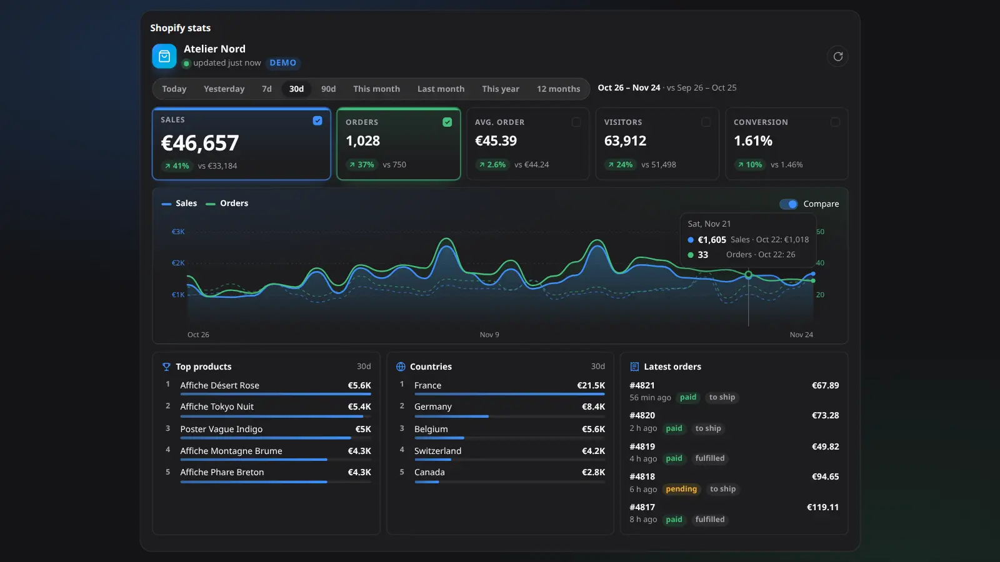
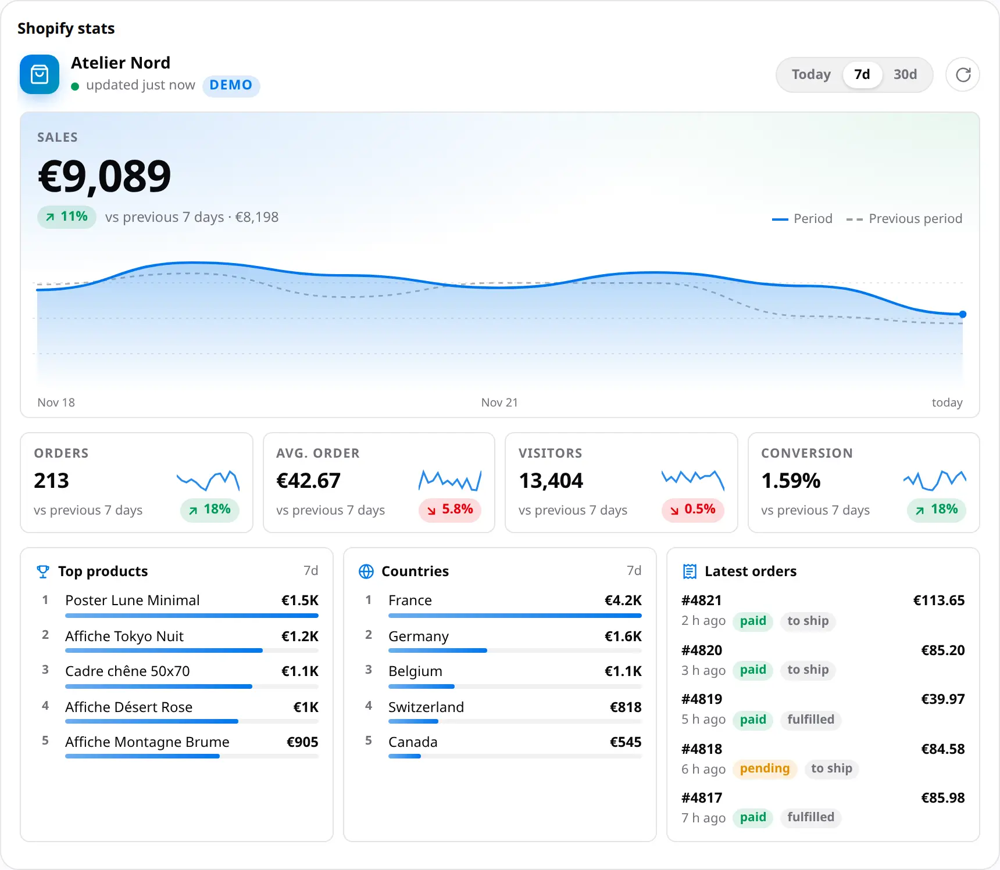
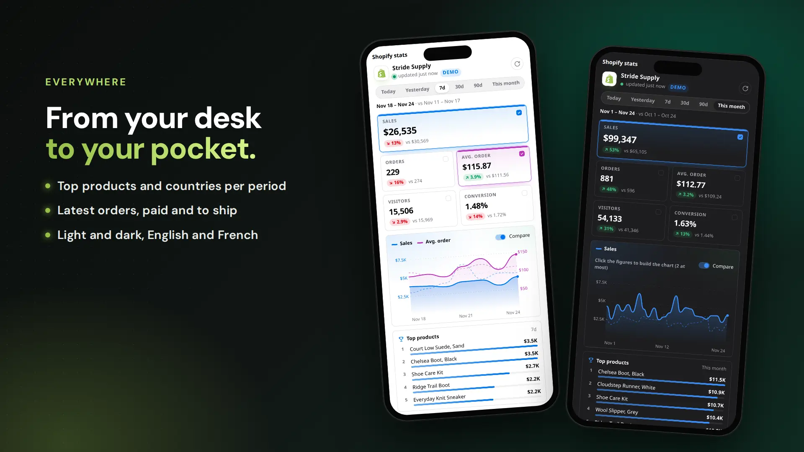
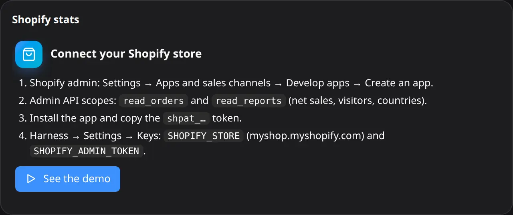

# Shopify stats · Harness Maxxing widget

A dashboard widget for [Harness Maxxing](https://harness-maxxing.com) that shows how your Shopify store is doing,
at a glance: sales with a comparison to the previous period, an interactive chart, orders, average order value,
visitors, conversion rate, top products, top countries and the latest orders.



- **Today / 7 days / 30 days** switch, each compared to the period before (dashed line on the chart).
- Hover or touch the chart for the figures of a day.
- Follows the Harness theme (dark and light, accent colour), fits any width down to a phone.
- **Read only**: it never changes anything in your store.
- English and French (follows the language of Harness).
- A **demo mode** with made-up figures, to try it before connecting a store.

| Light theme, 7 days | Phone width | Not connected yet |
|---|---|---|
|  |  |  |

All screenshots show demo data (a fictional store).

## Install

Ask Claude in any Harness Maxxing session:

> Install the widget https://github.com/romainmaxxing/harnessmaxxing-widget-shopify/tree/main/shopify-stats

or copy the `shopify-stats/` folder to `<workspace>/extensions/shopify-stats/` (the workspace is shown by
`maxxing status`, usually `~/maxxing`), then **Settings → Widgets → Rescan**. The widget appears on the dashboard.

## Connect your store

1. Shopify admin → **Settings → Apps and sales channels → Develop apps → Create an app**.
2. **Admin API scopes**: `read_orders` (required) and `read_reports` (net sales, visitors and countries, through
   ShopifyQL). Nothing else: the widget only reads.
3. **Install** the app and reveal the Admin API access token (`shpat_…`).
4. Harness Maxxing → **Settings → Keys**:

| Key | Value |
|---|---|
| `SHOPIFY_STORE` | `myshop.myshopify.com` |
| `SHOPIFY_ADMIN_TOKEN` | the `shpat_…` token |

Other accepted names: `SHOPIFY_SHOP` for the store, `SHOPIFY_ADMIN_ACCESS_TOKEN` for the token, or
`SHOPIFY_CLIENT_ID` + `SHOPIFY_CLIENT_SECRET` for an app of the Shopify Dev Dashboard (the widget then gets a
24-hour token by itself with the `client_credentials` grant, and renews it).

Without `read_reports` the widget falls back to the orders of the last 60 days (gross totals, no visitors and no
countries) and says so. To see the demo whatever the keys, add the key `SHOPIFY_STATS_DEMO` = `1`.

## What it does, what it sends where

- `api.py` runs inside the Harness Maxxing server (Python standard library only). It calls **only your store**:
  `https://<store>/admin/api/2025-10/graphql.json` (shop name, currency, time zone; ShopifyQL sales, sessions,
  top products and countries; the 6 latest orders: number, date, total and status, no customer data), and
  `https://<store>/admin/oauth/access_token` when you use the client ID / secret.
- Results are cached 5 minutes in the extension's private state folder (`stats.json`, and `token.json` for a
  client_credentials token, both readable by the owner only). The refresh button forces a new read, at most once
  every 30 seconds. The widget also refreshes itself every 5 minutes while the dashboard is open.
- `widget.html` is drawn in the sandboxed frame of Harness Maxxing: it loads nothing from the internet and only
  talks to its own `api.py`.

## Remove

Settings → Widgets → turn it off, or delete `<workspace>/extensions/shopify-stats/`. You can then delete the keys
from Settings → Keys and uninstall the Shopify app.

## Files

```
shopify-stats/
  manifest.json   widget declaration (id shopify-stats, span 2)
  api.py          reads the store (read only), demo data, cache
  widget.html     the widget: chart, figures, lists (inline CSS and JS, no dependency)
  README.md
```

## License

MIT
